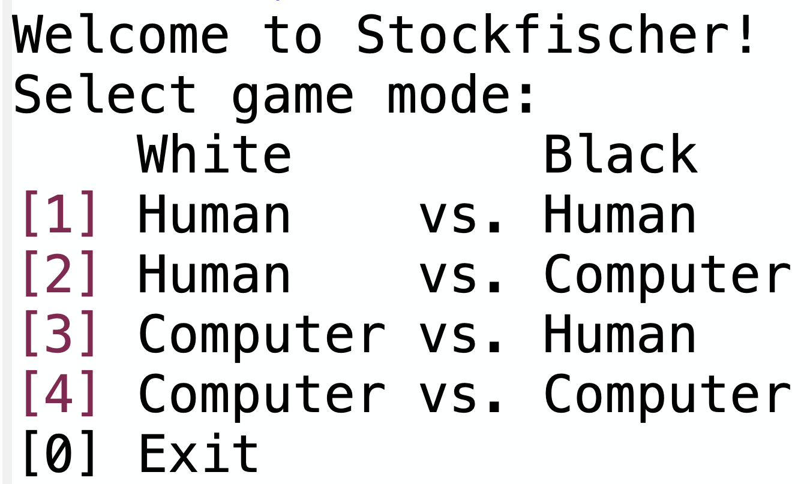
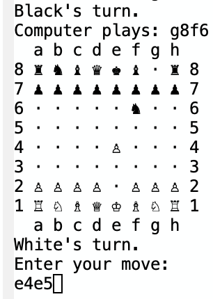

# Stockfischer

A chess CLI with an alpha-beta pruning engine.

## Overview

A chess command-line interface that allows you to play against another human, against the
computer, or even have the computer play against itself. The computer engine implements the
minimax algorithm with alpha-beta pruning.

### Main Menu

### Gameplay

To make a move, enter the piece's from and to squares. Here are some examples:

- e2e4 (white pawn push)
- e7e5 (black pawn push)
- e1g1 (white kingside castling)
- e7e8q (white pawn promotion to queen)
- e7e8r (white pawn promotion to rook)
- e7e8b (white pawn promotion to bishop)
- e7e8n (white pawn promotion to knight)
